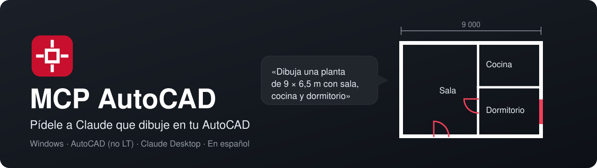
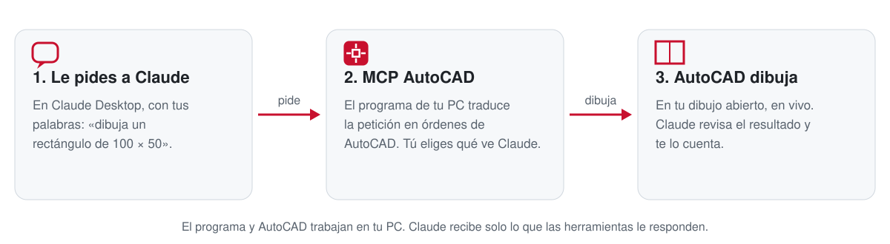
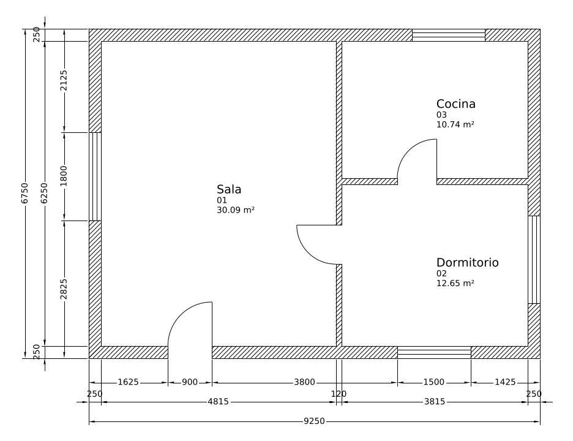
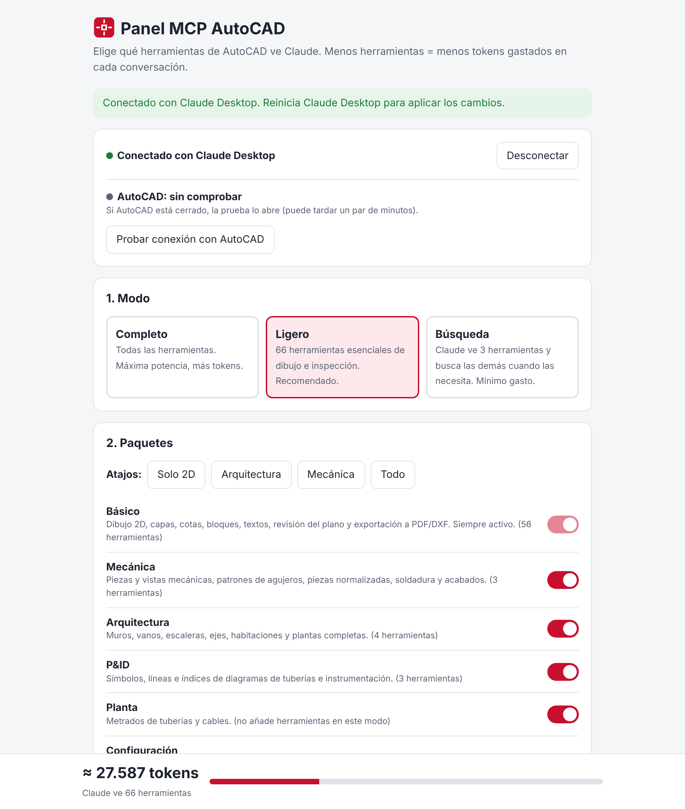
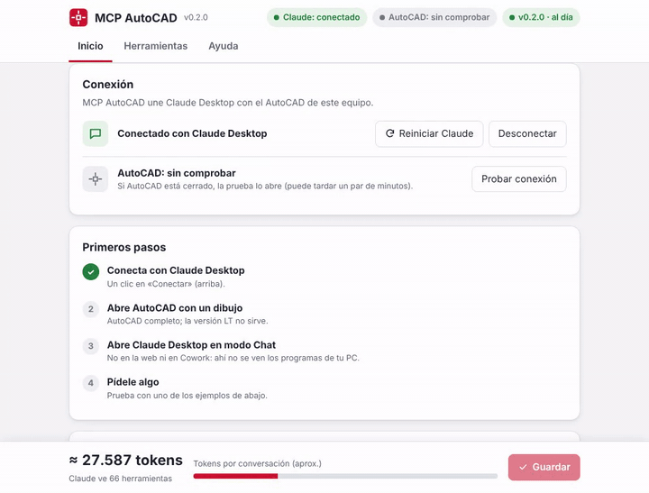
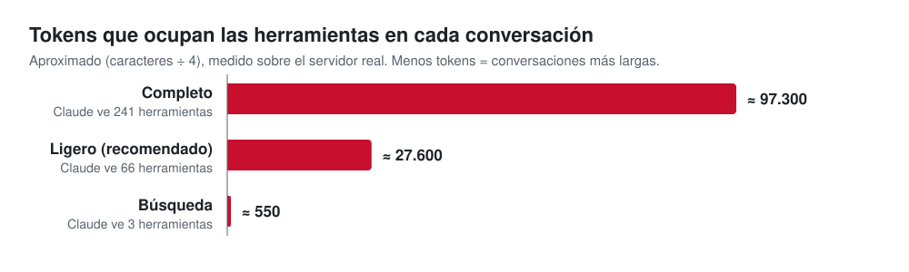
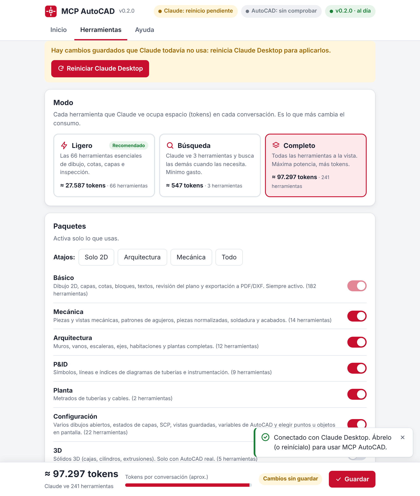
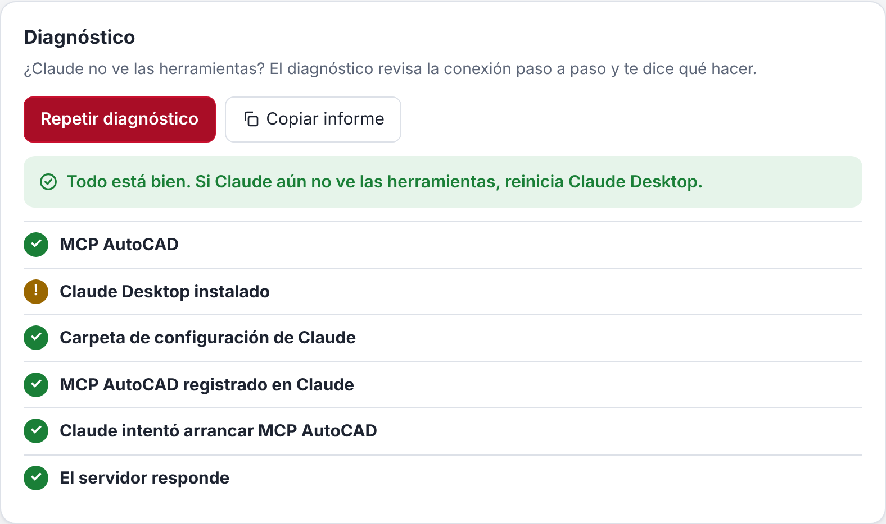

<div align="center">



[](https://github.com/amadevss/mcpautocad/releases/latest)
[](https://github.com/amadevss/mcpautocad/actions/workflows/construir-exe.yml)
[](https://github.com/amadevss/mcpautocad/releases)
[](LICENSE)

<a href="https://github.com/amadevss/mcpautocad/releases/latest/download/Instalar-MCP-AutoCAD.exe"></a>
<a href="https://github.com/amadevss/mcpautocad/releases/latest/download/MCP-AutoCAD.mcpb"></a>
<a href="https://github.com/amadevss/mcpautocad/releases/latest/download/MCP-AutoCAD-portatil.zip"></a>

**[Instalar](#-instalar-en-3-pasos)** · **[La app](#-la-app-mcp-autocad)** · **[Guía paso a paso](docs/GUIA.md)** · **[Problemas frecuentes](#-problemas-frecuentes)** · **[Novedades](CHANGELOG.md)** · **[Todas las versiones](https://github.com/amadevss/mcpautocad/releases)**

</div>

> [!NOTE]
> **Novedades de la v0.2.0:** app rediseñada con pestañas e indicadores de estado, avisos visuales, botón para
> **reiniciar Claude Desktop** con un clic, diagnóstico en vivo e instalador más pequeño (de 83 a 47 MB).
> [Ver todos los cambios](CHANGELOG.md).
>
> Probado con **AutoCAD 2025** y **Claude Desktop de Microsoft Store** en Windows 11, y con 103 pruebas automáticas.
> Si algo falla, [abre un aviso](https://github.com/amadevss/mcpautocad/issues) y pega el informe del botón
> **Diagnóstico** de la app (**Copiar informe**).

## ✨ Qué hace

Le pides a Claude con tus palabras lo que quieres dibujar y él lo dibuja en el AutoCAD abierto en tu PC: planos 2D,
cotas, capas, bloques, piezas mecánicas, plantas de arquitectura, diagramas P&ID y sólidos 3D.

<picture>
  <source media="(prefers-color-scheme: dark)" srcset="docs/img/como-funciona-oscuro.svg">
  
</picture>

### Un ejemplo real



<sub>Planta dibujada con una sola herramienta del servidor (<code>arch_plan_from_spec</code>): muros con sus uniones,
puertas, ventanas, cadenas de cotas y las áreas de cada habitación, que el servidor mide de los muros. Se generó sin
AutoCAD, con el motor ezdxf, usando <a href="scripts/ilustraciones/plano_ejemplo.py">este script</a>.</sub>

## 🚀 Instalar en 3 pasos

**Necesitas:** Windows 10/11 (64 bits), AutoCAD completo (**no LT**) y [Claude Desktop](https://claude.ai/download).
No hace falta instalar Python: va incluido.

### 1️⃣ Descarga el instalador

<a href="https://github.com/amadevss/mcpautocad/releases/latest/download/Instalar-MCP-AutoCAD.exe"></a>

Si Claude Desktop está abierto, el instalador te pedirá cerrarlo **por completo** (clic derecho en su icono junto al
reloj → *Salir*): Claude reescribe su configuración mientras está abierto y borraría la conexión.

### 2️⃣ Instálalo

Ábrelo y sigue el asistente. No pide permisos de administrador.

> [!WARNING]
> Si Windows muestra **«Windows protegió su PC»**, pulsa **Más información → Ejecutar de todas formas**.
> Sale porque el programa todavía no está firmado digitalmente.

Al terminar, MCP AutoCAD queda **conectado con Claude Desktop** y se abre la app **MCP AutoCAD** en su propia
ventana (también desde **Inicio → MCP AutoCAD** o el acceso directo del escritorio). Arriba verás los indicadores
de estado; **Claude: conectado** debe salir en verde:

<picture>
  <source media="(prefers-color-scheme: dark)" srcset="docs/img/panel-oscuro.png">
  
</picture>

### 3️⃣ Pruébalo

1. Abre **AutoCAD** con un dibujo y después **Claude Desktop** en modo **Chat** (no la web ni Cowork).
2. En una conversación nueva, el botón de herramientas (debajo del cuadro de texto) debe mostrar **autocad**.
3. Escribe, o copia uno de los ejemplos de la pestaña **Inicio** de la app:
   - *«Dime el estado de AutoCAD y qué dibujo tengo abierto»*
   - *«Dibuja un rectángulo de 100 × 50 y un círculo de radio 20 en su centro»*

> [!TIP]
> En la app, **Probar conexión** te dice si AutoCAD responde, su versión y el dibujo activo. Si Claude no ve las
> herramientas, ve a **Ayuda → Hacer diagnóstico**.

<details>
<summary><b>Otras formas de instalarlo: extensión .mcpb o versión portátil</b></summary>

**Extensión de Claude Desktop (.mcpb):** descarga
[`MCP-AutoCAD.mcpb`](https://github.com/amadevss/mcpautocad/releases/latest/download/MCP-AutoCAD.mcpb), haz doble clic
(o arrástralo a Claude Desktop → Configuración → Extensiones) y pulsa **Instalar**. Se configura en el formulario
de la extensión:

- **Modo**: escribe `ligero`, `completo` o `busqueda` (si escribes otra cosa se usa `ligero`). El formulario de
  extensiones no admite listas desplegables, por eso el modo se escribe.
- **Paquetes y 3D**: casillas de sí o no.
- **Herramientas apagadas (avanzado)**: nombres separados por comas. Vienen `system_run_command, system_run_lisp`
  (ver [Seguridad](#-seguridad)).

Después de cambiarla, desactiva y vuelve a activar la extensión.

**Portátil, sin instalar:** descarga
[`MCP-AutoCAD-portatil.zip`](https://github.com/amadevss/mcpautocad/releases/latest/download/MCP-AutoCAD-portatil.zip),
descomprímelo en una carpeta fija (por ejemplo `C:\MCP-AutoCAD`), haz doble clic en `MCP AutoCAD.exe` y pulsa
**Conectar con Claude Desktop**.

> [!IMPORTANT]
> Usa **una sola** de las tres formas. Con dos a la vez, Claude verá las herramientas repetidas.

</details>

## 🎛️ La app MCP AutoCAD

Ábrela desde **Inicio → MCP AutoCAD**. Se abre en su propia ventana (usa Microsoft Edge, que viene con Windows, sin
barra de direcciones), funciona solo en tu equipo y se cierra al cerrar la ventana. Tiene tres pestañas:

| Pestaña | Qué hay |
|---|---|
| **Inicio** | Conexión con Claude Desktop y AutoCAD, primeros pasos y ejemplos de qué pedirle a Claude, con botón para copiarlos. |
| **Herramientas** | Modo, paquetes y herramientas una por una, con el coste en tokens de cada opción. |
| **Ayuda** | Diagnóstico en vivo, problemas frecuentes y enlaces. |

Arriba de todo, tres **indicadores** te dicen siempre cómo va todo: **Claude** (conectado, reinicio pendiente o no
conectado), **AutoCAD** (abierto, responde o cerrado) y **Versión** (al día o hay una nueva). Las acciones se
confirman con **avisos** en la esquina, los botones muestran cuándo están trabajando, y la barra de abajo indica
**«Cambios sin guardar»** y los tokens de tu elección.



### Reiniciar Claude Desktop con un clic

Claude solo lee los cambios al arrancar. Después de conectar o guardar, el indicador pasa a **«reinicio pendiente»**
y aparece el botón **Reiniciar Claude Desktop**: cierra Claude (también el icono de la bandeja) y lo vuelve a abrir,
siempre preguntando antes. Si pulsas **Conectar** con Claude abierto, la app te ofrece **cerrarlo, conectar y volver
a abrirlo** sola. Tus conversaciones no se pierden: se guardan en la nube.

### Modo: lo que más cambia el consumo

<picture>
  <source media="(prefers-color-scheme: dark)" srcset="docs/img/tokens-oscuro.svg">
  
</picture>

| Modo | Para qué | Herramientas | Tokens aprox. |
|---|---|---|---|
| **Ligero** ✅ | El día a día: dibujo 2D, cotas, capas, bloques, revisión. **Recomendado.** | 66 | ~27.600 |
| **Búsqueda** | Gastar lo mínimo: Claude busca la herramienta que necesita cuando la necesita. | 3 (llega a 241) | ~550 |
| **Completo** | Todas a la vista, a cambio de más tokens. | 241 (246 con 3D) | ~97.300 |

### Paquetes y atajos

Interruptores para **Básico** (siempre activo), **Mecánica**, **Arquitectura**, **P&ID**, **Planta**,
**Configuración** y **3D**, más los atajos *Solo 2D*, *Arquitectura*, *Mecánica* y *Todo*. El contador de abajo
muestra en vivo cuántas herramientas y tokens supone tu elección.

<picture>
  <source media="(prefers-color-scheme: dark)" srcset="docs/img/panel-herramientas-oscuro.png">
  
</picture>

### Herramientas una por una

En **Herramientas → Herramientas una por una** puedes apagar herramientas concretas. Puedes buscarlas en español
(con o sin tildes) o en inglés, y cada una muestra lo que cuesta. Una herramienta apagada no la ve Claude ni puede
usarla.

> [!IMPORTANT]
> Después de **Guardar**, pulsa **Reiniciar Claude Desktop** para aplicar los cambios.

El panel también te avisa cuando hay una **versión nueva** en GitHub. Para eso solo lee la página pública de
versiones, sin enviar datos tuyos.

## 🔒 Seguridad

- El modo sin restricciones del original queda **siempre apagado** (`DANGEROUS_COMMANDS_ENABLED=false`).
- `system_run_command` y `system_run_lisp`, que ejecutan comandos y LISP de AutoCAD, vienen **apagadas por
  defecto**. El original bloquea una lista de comandos peligrosos (por ejemplo `ERASE`, `PURGE`, `SAVE`, `QUIT`, y en
  LISP `startapp`, `command` o borrar archivos), pero él mismo avisa de que esa lista protege de accidentes y no es
  una barrera de seguridad. Si las necesitas, enciéndelas en el panel; **Valores por defecto** las vuelve a apagar.
- El panel solo escucha en tu equipo y rechaza peticiones de otras páginas web.
- La configuración de Claude Desktop solo se cambia con Claude cerrado y se guarda antes una copia
  (`.bak-mcpautocad`). Tus otros servidores MCP y ajustes no se tocan.

## 🩺 Problemas frecuentes

> [!TIP]
> **Empieza por Ayuda → Hacer diagnóstico.** Revisa, paso a paso y en vivo, dónde guarda Claude Desktop su
> configuración, si MCP AutoCAD está registrado, si Claude intentó arrancarlo (y con qué error) y si el servidor
> responde, y te dice en una frase qué hacer. Con **Copiar informe** puedes mandarlo a soporte. También funciona
> desde una consola: `mcpautocad.exe diagnostico`.

<picture>
  <source media="(prefers-color-scheme: dark)" srcset="docs/img/panel-diagnostico-oscuro.png">
  
</picture>

| Problema | Solución |
|---|---|
| No aparece **autocad** en Claude | Pulsa **Diagnóstico**. Lo más habitual: Claude Desktop no se reinició del todo (sal desde la bandeja, no basta con cerrar la ventana), o estás en la web o en otra pestaña en lugar del chat de la app instalada. |
| Claude no encuentra AutoCAD | Pulsa **Probar conexión con AutoCAD**. Si AutoCAD está cerrado, el servidor intenta abrirlo (puede tardar). AutoCAD **LT no sirve**: no tiene la interfaz COM. |
| Uso Claude Desktop de Microsoft Store | Se detecta solo, también cuando Claude movió su configuración a `%LOCALAPPDATA%\Claude-Data`. Si no funciona, cierra Claude desde la bandeja y pulsa **Conectar con Claude Desktop** en el panel. |
| «Conectar» dice que Claude está abierto | Claude reescribe su configuración mientras está abierto y borraría el cambio. Acepta **Cerrar, conectar y abrir** y la app lo hace sola. |
| El botón «Reiniciar Claude» no lo vuelve a abrir | Ábrelo tú desde el menú Inicio: los cambios ya están aplicados. |
| No aparecen las herramientas 3D | Activa **3D** y usa el modo Completo o Búsqueda: Ligero no las incluye. |
| Quiero ver qué pasa por dentro | Abre `%LOCALAPPDATA%\Claude\logs\mcp-server-autocad.log` (o `%APPDATA%\Claude\logs\` con el instalador clásico de Claude). |

**Desinstalar:** *Configuración de Windows → Aplicaciones → MCP AutoCAD → Desinstalar* (también se quita de Claude
Desktop). La extensión se quita desde Claude Desktop → Configuración → Extensiones.

**Archivos que usa:** la configuración del panel está en `%APPDATA%\mcpautocad\config.json`. La de Claude Desktop
depende de cómo lo instalaste; el **Diagnóstico** te dice cuál usa. Antes de cambiarla se guarda una copia
`claude_desktop_config.json.bak-mcpautocad`.

## 🙏 Créditos

Todo el trabajo de dibujo es de **[AutoCAD MCP Pro](https://github.com/U-C4N/Autocad-MCP)** (paquete
`autocad-mcp-pro` 1.7.0), creado por **Umutcan Edizsalan** con licencia MIT. Este proyecto lo empaqueta, lo
configura y lo instala en español, sin copiar su código.

---

## 🛠️ Para desarrolladores

<details>
<summary><b>Estructura del proyecto</b></summary>

```
mcpautocad/
  iniciar.py          lee config.json, pone las variables y arranca el servidor original por stdio
  configuracion.py    leer/guardar config.json y traducirlo a variables de entorno
  panel.py            panel local (http.server de la biblioteca estándar) + panel.html
  registrar.py        agrega/quita la entrada "autocad" en claude_desktop_config.json
  catalogo.py         estimación de herramientas y tokens (datos en catalogo.json)
  probar.py           "Probar conexión": arranca el servidor y llama a system_status
  diagnostico.py      botón «Diagnóstico»: configuración de Claude, registro, registros de Claude y servidor
  ventana.py          abre el panel en ventana propia (modo aplicación de Edge/Chrome)
  procesos.py         si Claude/AutoCAD están abiertos; cerrar y volver a abrir Claude Desktop
  actualizaciones.py  aviso de versión nueva (último Release de GitHub)
  traducciones.json   descripciones cortas en español para el panel
  __main__.py         mcpautocad [panel|servidor|registrar|quitar|probar|diagnostico]
scripts/
  medir_tokens.py     regenera catalogo.json midiendo el servidor real
  generar_icono.py    genera los iconos (instalador/, mcpautocad/icono.png y mcpb/icon.png)
  empaquetar_mcpb.py  crea la extensión .mcpb (usa @anthropic-ai/mcpb)
  ilustraciones/      genera las imágenes de este README (ver abajo)
mcpb/manifest.json    manifiesto de la extensión (la versión se pone al empaquetar)
mcpautocad.spec       receta de PyInstaller: mcpautocad.exe (consola, para Claude) y «MCP AutoCAD.exe» (ventana),
                      que comparten el código (noarchive) para no duplicar 26 MB
construir.ps1         construye el .exe, el instalador, el .zip y el .mcpb en Windows
instalador/           instalador de Inno Setup e iconos
docs/                 plan del proyecto, notas de los Releases e imágenes
```

</details>

<details>
<summary><b>Variables que se pasan al servidor original</b></summary>

| Panel | Variable |
|---|---|
| Modo Completo / Ligero / Búsqueda | `TOOL_PROFILE=full` / `lean` / `full` y `DISCOVERY_MODE=off` / `off` / `search` |
| Paquetes | `TOOL_PACKS=core,mech,arch,pid,plant,settings` (solo los activos; `core` siempre) |
| 3D | `ENABLE_3D=true/false` |
| Motor | `AUTOCAD_MCP_BACKEND=com` (por defecto; `"motor": "ezdxf"` en config.json para trabajar sin AutoCAD) |
| Siempre | `DANGEROUS_COMMANDS_ENABLED=false` |
| Por defecto | `"desactivadas": ["system_run_command", "system_run_lisp"]` en config.json (se quitan al arrancar) |

Con la extensión .mcpb, la configuración llega en variables `MCPAUTOCAD_MODO`, `MCPAUTOCAD_MECANICA`,
`MCPAUTOCAD_ARQUITECTURA`, `MCPAUTOCAD_PID`, `MCPAUTOCAD_PLANTA`, `MCPAUTOCAD_CONFIGURACION`, `MCPAUTOCAD_3D` y
`MCPAUTOCAD_DESACTIVADAS` (con `MCPAUTOCAD_ORIGEN=mcpb`) y sustituye a `config.json`.

</details>

### Probar sin AutoCAD

Los tests usan el motor **ezdxf**, que funciona en cualquier sistema:

```bash
python -m pip install -e ".[dev]"
```

```bash
python -m pytest -q
```

Abrir el panel en desarrollo:

```bash
python -m mcpautocad panel
```

Al actualizar `autocad-mcp-pro`:
1. Cambia `VERSION_ORIGINAL` en `mcpautocad/__init__.py` y la dependencia en `pyproject.toml`.
2. Regenera el catálogo:

```bash
python scripts/medir_tokens.py
```

3. Traduce en `mcpautocad/traducciones.json` las herramientas nuevas; un test te dirá cuáles faltan.

### Imágenes del README

```bash
python scripts/ilustraciones/generar_svg.py
```

```bash
python scripts/ilustraciones/plano_ejemplo.py docs/img/ejemplo-plano.png
```

```bash
node scripts/ilustraciones/capturas_panel.js python
```

El primero genera el banner, el diagrama, la gráfica de tokens (con las cifras del catálogo real) y los botones;
el segundo dibuja la planta de ejemplo con el servidor; el tercero abre el panel de verdad y saca las capturas y el
GIF (necesita Node.js con Playwright y ffmpeg).

### Construir y publicar

En Windows con Python 3.11+ ([Inno Setup 6](https://jrsoftware.org/isinfo.php) para el instalador y Node.js
para la extensión):

```powershell
powershell -ExecutionPolicy Bypass -File construir.ps1
```

Deja en `salida/` los tres archivos con nombre fijo: `Instalar-MCP-AutoCAD.exe`, `MCP-AutoCAD-portatil.zip` y
`MCP-AutoCAD.mcpb`. Los nombres no llevan la versión para que los botones de este README apunten siempre a la última.

GitHub Actions (`.github/workflows/construir-exe.yml`) prueba en Linux y en Windows en cada push y sube los archivos
como artefacto.

**Publicar una versión nueva, sin usar git:**
1. Sube el número en `pyproject.toml` y `mcpautocad/__init__.py` (por ejemplo a `0.1.1`) y fusiónalo en `main`.
2. Ve a **Actions → Construir .exe → Run workflow**, elige la rama `main`, marca **Publicar** y pulsa **Run workflow**.
3. En unos 6 minutos aparece el **Release** `v0.1.1` con los tres archivos y los botones de descarga de este README
   pasan a esa versión. Sus notas se arman solas (`scripts/notas_release.py`): el apartado de esa versión en
   [CHANGELOG.md](CHANGELOG.md) más las instrucciones de `docs/NOTAS_RELEASE.md`. Antes de publicar, añade el
   apartado al CHANGELOG (un test lo exige).

También se publica al subir una etiqueta `v*`, que debe coincidir con la versión del código:

```bash
git tag v0.1.0
```

```bash
git push origin v0.1.0
```

## 📄 Licencia

MIT. Ver [LICENSE](LICENSE), que incluye el aviso de licencia de
[AutoCAD MCP Pro](https://github.com/U-C4N/Autocad-MCP) © 2026 Umutcan Edizsalan.

El plan de las siguientes fases está en [docs/PLAN.md](docs/PLAN.md).
