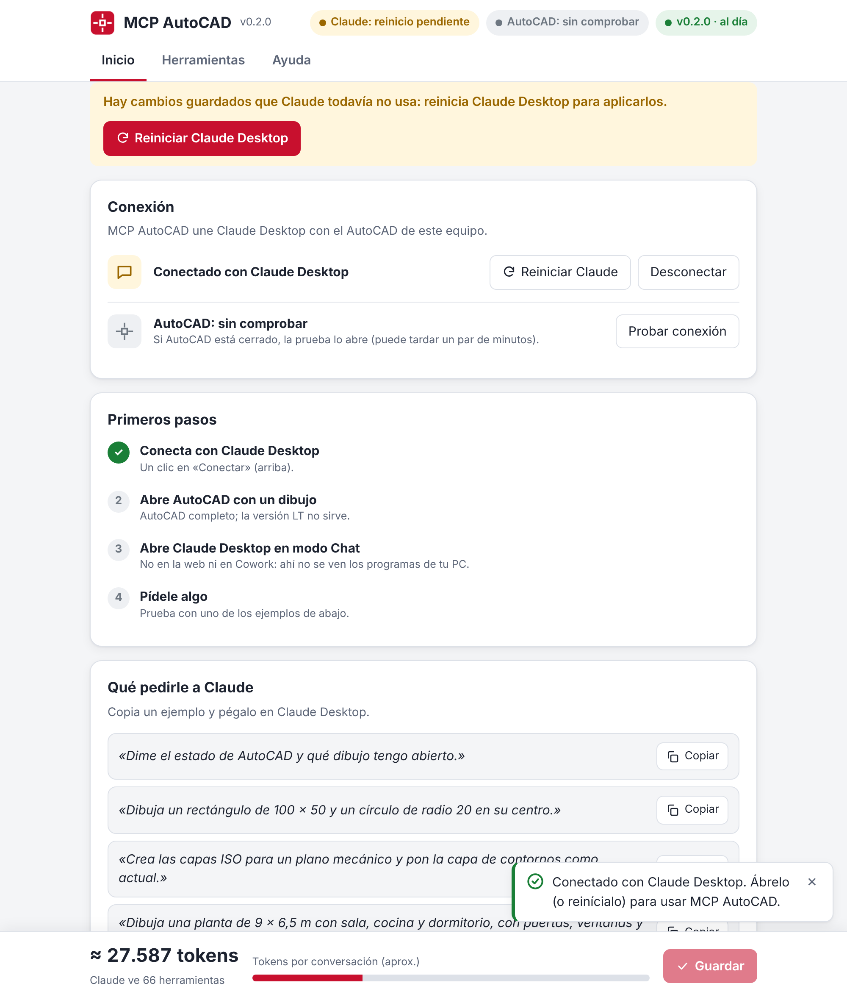
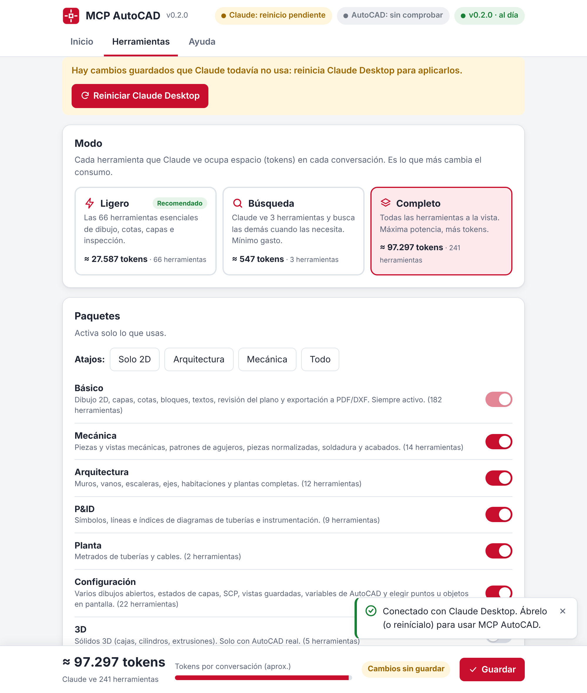
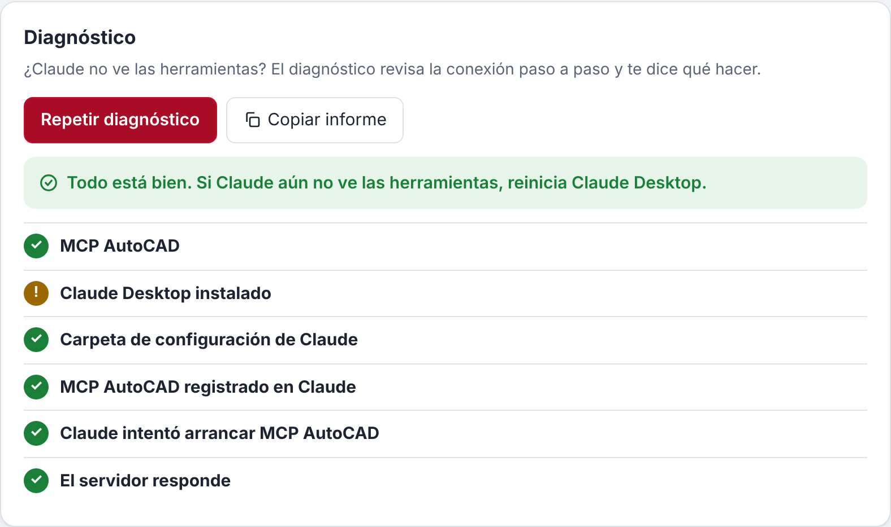

# Guía paso a paso de MCP AutoCAD

Esta guía es para quien nunca ha usado MCP AutoCAD. En 10 minutos tendrás a Claude dibujando en tu AutoCAD.

**Necesitas:** Windows 10 u 11 (64 bits), AutoCAD completo (**no LT**) y la aplicación
[Claude Desktop](https://claude.ai/download) instalada (no basta con claude.ai en el navegador).

---

## 1. Instalar

1. Descarga el instalador:
   **[Instalar-MCP-AutoCAD.exe](https://github.com/amadevss/mcpautocad/releases/latest/download/Instalar-MCP-AutoCAD.exe)**.
2. Ábrelo. Si Windows muestra **«Windows protegió su PC»**, pulsa **Más información → Ejecutar de todas formas**.
   Sale porque el programa todavía no está firmado digitalmente.
3. Si Claude Desktop está abierto, el instalador te pedirá cerrarlo: clic derecho en el icono de Claude junto al
   reloj → **Salir**, y después **Reintentar**.
4. Sigue el asistente. No pide permisos de administrador.

Al terminar se abre la app **MCP AutoCAD**. Si actualizas desde otra versión, instala encima: no hace falta desinstalar.

## 2. Comprobar que está conectado

En la parte de arriba de la app hay tres indicadores:

| Indicador | Qué significa |
|---|---|
| 🟢 **Claude: conectado** | MCP AutoCAD está registrado en Claude Desktop. |
| 🟡 **Claude: reinicio pendiente** | Hay cambios que Claude aún no usa: pulsa **Reiniciar Claude Desktop**. |
| 🔴 **Claude: no conectado** | Pulsa **Conectar con Claude Desktop** en la pestaña Inicio. |
| **AutoCAD: abierto / responde / cerrado** | Si AutoCAD está abierto. **Probar conexión** lo confirma. |
| **Versión: al día / nueva versión** | Si hay una versión más nueva para descargar. |

## 3. Probar con AutoCAD

1. Abre **AutoCAD** con un dibujo (puede ser uno nuevo).
2. En la app, pestaña **Inicio**, pulsa **Probar conexión**. Debe decir **«AutoCAD responde»**, con la versión y el
   nombre del dibujo.
3. Si acabas de conectar o de guardar cambios, pulsa **Reiniciar Claude Desktop** (o cierra Claude desde la bandeja
   y ábrelo).

## 4. Pedirle cosas a Claude

1. Abre **Claude Desktop** y usa el modo **Chat**. En la web o en Cowork no se ven los programas de tu PC.
2. En una conversación nueva, pega uno de los ejemplos de la pestaña **Inicio** (botón **Copiar**). Por ejemplo:
   - *«Dime el estado de AutoCAD y qué dibujo tengo abierto.»*
   - *«Dibuja un rectángulo de 100 × 50 y un círculo de radio 20 en su centro.»*
   - *«Dibuja una planta de 9 × 6,5 m con sala, cocina y dormitorio, con puertas, ventanas y cotas.»*
3. La primera vez, Claude te pedirá permiso para usar las herramientas de **autocad**: acéptalo.

## 5. Elegir qué herramientas ve Claude (opcional)

Cada herramienta que Claude ve ocupa espacio (tokens) en cada conversación. En la pestaña **Herramientas**:

- **Modo**: **Ligero** (recomendado, 66 herramientas), **Búsqueda** (Claude ve solo 3 y busca las demás) o
  **Completo** (todas). Cada tarjeta muestra cuántos tokens supone.
- **Paquetes**: activa solo lo que usas (Mecánica, Arquitectura, P&ID, Planta, Configuración, 3D).
- **Herramientas una por una**: para apagar herramientas concretas.

Cuando cambias algo, abajo aparece **«Cambios sin guardar»**. Pulsa **Guardar** y después **Reiniciar Claude Desktop**.

## 6. Si algo no funciona

Ve a la pestaña **Ayuda** y pulsa **Hacer diagnóstico**. Cada comprobación aparece en cuanto termina, con lo que hay
que hacer si algo falla. Para pedir ayuda, pulsa **Copiar informe** y pégalo en un
[aviso en GitHub](https://github.com/amadevss/mcpautocad/issues).

Los problemas más comunes:

- **Claude no ve las herramientas.** Reinicia Claude Desktop, y comprueba que usas la app instalada en modo **Chat**.
- **«Claude Desktop está abierto» al conectar.** Acepta **Cerrar, conectar y abrir**: la app lo hace sola. Tus
  conversaciones no se pierden.
- **Claude no encuentra AutoCAD.** Abre AutoCAD con un dibujo y pulsa **Probar conexión**. AutoCAD LT no sirve.

## 7. Desinstalar

*Configuración de Windows → Aplicaciones → MCP AutoCAD → Desinstalar.* También se quita de Claude Desktop, sin tocar
tus otros ajustes.
